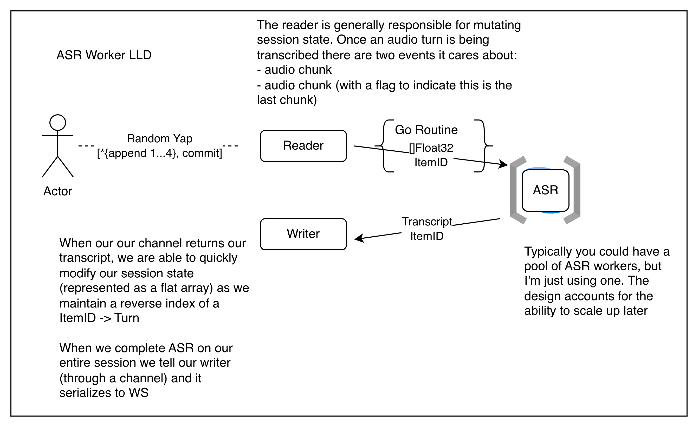

# Coordinator

Authenticated WebSocket audio ingestion and in-process streaming ASR. See the
[Bidirectional Inference design](https://ubc-inference.github.io/Quickstart/#/bidirectional-inference)
for project goals. vLLM generation is not implemented: there are no speculative
requests, `response.*` events, or placeholder generation interface.

## Model Setup

Use Go 1.24+, a C/C++ toolchain, and `CGO_ENABLED=1`. The official
`github.com/k2-fsa/sherpa-onnx-go` binding is pinned to **v1.13.8** and links
platform-specific dynamic libraries, including ONNX Runtime. Model files are
external runtime inputs, not downloaded by the server or baked into the image.
Never commit model archives, ONNX files, native binaries, or audio fixtures.

Download the English `sherpa-onnx-streaming-zipformer-en-20M-2023-02-17`
model outside the repository. These shell commands use `/tmp`; substitute an
absolute user-owned directory for persistent storage:

```sh
export ASR_DOWNLOAD_DIR=/tmp
export ASR_MODEL_NAME=sherpa-onnx-streaming-zipformer-en-20M-2023-02-17
curl -fL "https://github.com/k2-fsa/sherpa-onnx/releases/download/asr-models/${ASR_MODEL_NAME}.tar.bz2" \
  -o "$ASR_DOWNLOAD_DIR/$ASR_MODEL_NAME.tar.bz2"
tar -xjf "$ASR_DOWNLOAD_DIR/$ASR_MODEL_NAME.tar.bz2" -C "$ASR_DOWNLOAD_DIR"
export ASR_MODEL_DIR="$ASR_DOWNLOAD_DIR/$ASR_MODEL_NAME"
export ASR_ENCODER_PATH="$ASR_MODEL_DIR/encoder-epoch-99-avg-1.int8.onnx"
export ASR_DECODER_PATH="$ASR_MODEL_DIR/decoder-epoch-99-avg-1.onnx"
export ASR_JOINER_PATH="$ASR_MODEL_DIR/joiner-epoch-99-avg-1.int8.onnx"
export ASR_TOKENS_PATH="$ASR_MODEL_DIR/tokens.txt"
```

This is the documented mixed configuration: **int8 encoder, fp32 decoder,
int8 joiner**, plus `tokens.txt`. All four `ASR_*_PATH` variables are required;
each must name a readable, nonempty regular file. `ASR_MODEL_DIR` is only a
convenience for shell/Compose setup, not a server setting.

The recognizer uses CPU, `model_type=zipformer`, one inference thread,
`greedy_search`, 80-dimensional features at 16 kHz, and disabled automatic
endpointing. Incoming 24 kHz samples are passed with their actual rate to
sherpa-onnx, which resamples to 16 kHz internally.

From `coordinator/`, with the model exports above:

```sh
export CGO_ENABLED=1
export COORDINATOR_API_KEY=local-development-key
export PORT=8080
go run .
```

The packaged native platforms are Linux `amd64`, `arm64`, and `arm` (glibc),
macOS `amd64` and `arm64`, and Windows `amd64` and `386`. This Dockerfile supports
Linux `amd64` and `arm64` only. Alpine/musl is not supported by these packaged
Linux libraries. PortAudio is not required: audio arrives over WebSocket, and
the preview client uses miniaudio for optional local microphone capture. When
deploying a local compiled executable separately, also deploy the matching
native libraries and make them discoverable by the platform's dynamic loader;
it is not a standalone static Go binary.

## Client API

`GET /v1/realtime` upgrades an authenticated HTTP request to a WebSocket. Supply:

```text
Authorization: Bearer $COORDINATOR_API_KEY
```

`GET /healthz` is unauthenticated for health checks. One WebSocket connection
owns one in-memory session; disconnecting discards it. JSON messages follow the
OpenAI Realtime event shape, with the custom transcript revision event below.

Accepted client events:

- `session.update`: validates session settings and updates `instructions`.
- `input_audio_buffer.append`: submits base64 audio; no append acknowledgement.
- `input_audio_buffer.commit`: commits the current nonempty turn.
- `input_audio_buffer.clear`: discards the pending turn, not committed history.

Server events:

- `session.created` and `session.updated`.
- `input_audio_buffer.committed` and `input_audio_buffer.cleared`.
- `conversation.item.input_audio_transcription.updated` (custom full replacement).
- `conversation.item.input_audio_transcription.completed` (standard final event).
- `conversation.item.input_audio_transcription.failed` (standard failure event).
- `error`: invalid or unsupported client events do not close the session.

Session configuration is `type: "realtime"`,
`model: "Qwen/Qwen2.5-7B-Instruct"`, `output_modalities: ["text"]`, and
`audio.input.format: {"type": "audio/pcm", "rate": 24000}`. The model field is
protocol metadata, not an active LLM. Only the supported values are accepted;
`instructions` can be changed but has no generation effect yet.

## Audio And Transcripts

Audio is **PCM16, 24 kHz, mono, little-endian**, base64-encoded in the `audio`
field. Do not send WAV headers. Each chunk must contain complete 16-bit samples.
The cumulative input limit is 60 seconds per turn; the WebSocket message limit
is 16 MiB. Empty commits fail with `input_audio_buffer_commit_empty`.

The first valid append allocates `item_1`, then `item_2`, and so on within the
session. The ID remains the same through partials, commit, and final result.
IDs are never reused within a session, including after clear. Invalid appends
do not allocate IDs. Transcript events carry `item_id`, `content_index: 0`, and,
for successful updates/completion, a monotonically increasing per-item
`revision` starting at 1. Each event also has its own `event_id`.

```json
{
  "event_id": "event_example",
  "type": "conversation.item.input_audio_transcription.updated",
  "item_id": "item_1",
  "content_index": 0,
  "revision": 2,
  "transcript": "the entire current hypothesis"
}
```

Replace the displayed transcript for that item; do not concatenate it. There
are **no transcript deltas and no guaranteed stable prefix**. Unchanged partial
hypotheses are suppressed. Completion carries the full final `transcript` and
a new revision even if its text matches the last partial. Silence can complete
successfully with `transcript: ""` and no preceding partials.

`input_audio_buffer.committed` is queued before the final transcription event.
It carries `item_id` and, when present, `previous_item_id` from the preceding
committed history item. Commit acknowledges acceptance, not ASR completion.
Clients can start another turn while the committed turn is finishing; match
results by item ID rather than assuming they belong to the pending turn.

`input_audio_buffer.cleared` includes the discarded `item_id` when there was a
pending turn; an empty clear has no `item_id`. Results arriving later for that
cleared item are ignored. Previously delivered partials cannot be retracted,
so clients should discard their display when clear is acknowledged.

Recoverable stream errors emit one transcription `failed` event with
`content_index: 0` and an `error` containing `type: "server_error"`,
`code: "transcription_failed"`, and a message. Further appends to a failed turn
are rejected until clear or commit. Native aborts, crashes, and fatal model
errors are not recoverable Go errors and may terminate the process. Raw audio
is not retained for retry: the client must resend it in a new turn/session.

## Ownership And Lifecycle



The sketch combines socket reading and session ownership into its "Reader"
box. In the implementation, only the session owner changes history; worker
results pass through that owner before reaching the socket writer. Commit is
a separate event, not a last-chunk flag, and completion ends an audio turn,
not the entire session.

A **session** is the connection's configuration, pending turn, and ordered
conversation history. A **turn** is audio between its first accepted append
and commit or clear. One process-wide native recognizer shares model resources
across sessions; each session has one ASR worker, which exclusively owns a
fresh native stream per turn. No two goroutines operate on the same stream.
Finishing a turn releases its stream; the worker remains available for later turns.

Commit adds a user history item immediately, then updates its transcript and
revision as results arrive. History retains transcripts and metadata, not PCM;
it is in memory, has no persistence or item-count retention bound, and disappears
on disconnect. Queued chunks and native feature/model state still consume
memory while processing.

The owner indexes only committed items still awaiting transcription by item ID
and history position. Finishing a turn, successfully or with an error, removes
that index entry without removing history. Results are correlated by ID rather
than by arrival order; the current worker still processes turns sequentially.

Fresh streams receive 0.5 seconds of leading silence, following the upstream
native file CLI, to support recognition at the start of a recording. The
adapter feeds at most 100 ms before draining available decoding. This and
the finish padding are supplied immediately, not paced as a wall-clock delay.
To finish a turn, the worker feeds **0.8 seconds of synthetic silence**, calls
`InputFinished`, drains ready decoding, retrieves the final text, and deletes
the stream. Clear, stream failure, and disconnect also close streams. Turns
use fresh streams, not `Reset`: upstream transducer reset can preserve encoder
and token context and explicitly does not discard underlying audio samples.
The recognizer is deleted only after all session workers have exited.

Each session has a WebSocket **reader**, state **owner**, ASR **worker**, and
WebSocket **writer**. Only the owner mutates session/history state, and only
the writer writes JSON to the socket. Bounded channels hold 16 client events,
16 ASR commands, 16 results, and 32 outbound events. ASR commands run FIFO;
backpressure does not drop audio or reorder commit/clear ahead of appends.
When the command channel saturates, the owner stops accepting client events
but continues consuming worker results while waiting to enqueue its pending
command. As the client-event channel fills, socket reading pauses. A slow
writer can also backpressure the owner; writes have a 10-second deadline.
Clear can wait behind earlier commands and an in-progress native call.

Disconnect/process cancellation closes the socket and stops queued work, but
native calls already executing cannot be interrupted by Go context cancellation.
Shutdown has a five-second HTTP deadline **but still waits for handlers and
ASR workers before deleting the shared recognizer**; total shutdown can exceed
five seconds. Go's race detector does not establish native-library thread safety.

This small LibriSpeech-trained model is sensitive to startup padding and
decoding cadence. Local checks recovered the upstream sample's opening with
the configuration above, but neither partial nor completed text is guaranteed
accurate. Validate it against conversational recordings before relying on it.

Sharing is based on the selected CPU transducer implementation: upstream
`CreateStream` initializes independent stream states, and `DecodeStreams`
uses per-call buffers and reads/writes the supplied stream's state. This is
source evidence for this configuration, not a blanket thread-safety guarantee
for every sherpa-onnx model, provider, or API. Recheck native behavior when
upgrading or changing configuration.

## Preview And Checks

Run commands here from `coordinator/`. In another terminal with the same
`COORDINATOR_API_KEY`, convert a recording and stream its WAV contents in paced
100 ms chunks:

```sh
ffmpeg -i /path/to/recording.wav -ac 1 -ar 24000 -c:a pcm_s16le /tmp/preview-24k.wav
go run ./cmd/preview -wav /tmp/preview-24k.wav -url ws://localhost:8080/v1/realtime
```

Use the default local microphone instead of a WAV file with:

```sh
go run ./cmd/preview -mic -url ws://localhost:8080/v1/realtime
```

Press Enter to stop recording and commit the captured audio. Exactly one of
`-wav` or `-mic` is required; `-url` defaults to the URL above. Authentication
comes from the environment, not a key flag. The CLI prints full
updated/completed JSON, exits on completion/failure, and times out 30 seconds
after commit. WAV input must be nonempty PCM16 mono 24 kHz RIFF/WAVE audio.

```sh
go test ./...
go test -race ./...
go vet ./...
go test -tags asr_smoke -run TestNativeASRSmoke -v .
```

Normal tests use fake recognizers for protocol/worker behavior but still need
cgo and the native linkage to build. The opt-in `asr_smoke` test needs all four
model path exports; without them it skips, so a skipped run is not native
validation. It checks 24 kHz silence, fresh streams, and concurrent independent
streams sharing the recognizer. Optional speech input
must be **raw** mono little-endian PCM16 at 24 kHz, without a WAV header:

```sh
ffmpeg -i /path/to/recording.wav -ac 1 -ar 24000 -c:a pcm_s16le -f s16le /tmp/asr-smoke.pcm
export ASR_SMOKE_PCM_PATH=/tmp/asr-smoke.pcm
export ASR_SMOKE_EXPECT_TRANSCRIPT="a phrase in the recording"
go test -tags asr_smoke -run TestNativeASRSmoke -v .
```

`ASR_SMOKE_EXPECT_TRANSCRIPT` is optional and checks a case-insensitive substring;
speech input must produce a nonempty transcript even without that assertion.

## Docker And Compose

From the repository root, build with `coordinator/` as the context and mount
the extracted model directory read-only. Reuse the setup exports above:

```sh
docker build -t toy-coordinator ./coordinator
docker run --rm -p 8080:8080 \
  -v "$ASR_MODEL_DIR:/models:ro" \
  -e PORT=8080 \
  -e COORDINATOR_API_KEY \
  -e ASR_ENCODER_PATH=/models/encoder-epoch-99-avg-1.int8.onnx \
  -e ASR_DECODER_PATH=/models/decoder-epoch-99-avg-1.onnx \
  -e ASR_JOINER_PATH=/models/joiner-epoch-99-avg-1.int8.onnx \
  -e ASR_TOKENS_PATH=/models/tokens.txt \
  toy-coordinator
```

The image contains the Go executable and matching dynamic libraries, not model
weights. Compose uses the same contract: an absolute host
`ASR_MODEL_DIR` mounted at `/models:ro`, with all four paths explicitly set to
**container paths**, not inherited host paths:

```yaml
services:
  coordinator:
    volumes:
      - "${ASR_MODEL_DIR:?ASR_MODEL_DIR is required}:/models:ro"
    environment:
      ASR_ENCODER_PATH: /models/encoder-epoch-99-avg-1.int8.onnx
      ASR_DECODER_PATH: /models/decoder-epoch-99-avg-1.onnx
      ASR_JOINER_PATH: /models/joiner-epoch-99-avg-1.int8.onnx
      ASR_TOKENS_PATH: /models/tokens.txt
```

This excerpt is already configured in `compose.yaml`. Set `ASR_MODEL_DIR`,
`COORDINATOR_PORT`, `COORDINATOR_API_KEY`, and `VLLM_BASE_URL`, then run
`docker compose up --build`. There are still only coordinator and vllm services.
The coordinator itself reads `PORT` (default `8080`), `COORDINATOR_API_KEY`, and
the four required ASR paths. `VLLM_BASE_URL` remains a Compose/planned integration
setting; the coordinator does not read or validate it yet.

## Sources

- [Official model instructions and mixed int8 example](https://k2-fsa.github.io/sherpa/onnx/pretrained_models/online-transducer/zipformer-transducer-models.html#csukuangfj-sherpa-onnx-streaming-zipformer-en-20m-2023-02-17-english).
- [Official Go binding v1.13.8](https://github.com/k2-fsa/sherpa-onnx-go/tree/v1.13.8) and its platform modules: [Linux](https://github.com/k2-fsa/sherpa-onnx-go-linux/tree/v1.13.8), [macOS](https://github.com/k2-fsa/sherpa-onnx-go-macos/tree/v1.13.8), [Windows](https://github.com/k2-fsa/sherpa-onnx-go-windows/tree/v1.13.8).
- [Native transducer stream creation, decoding, and Reset semantics](https://github.com/k2-fsa/sherpa-onnx/blob/v1.13.8/sherpa-onnx/csrc/online-recognizer-transducer-impl.h).
- [Native feature extraction and resampling](https://github.com/k2-fsa/sherpa-onnx/blob/v1.13.8/sherpa-onnx/csrc/features.cc).
- Local implementation: [native configuration/lifecycle](asr_native.go), [FIFO worker](asr_worker.go), [session ownership/backpressure](realtime.go), [client-event handling](session_events.go), [startup](main.go), and [shutdown ordering](server.go).
